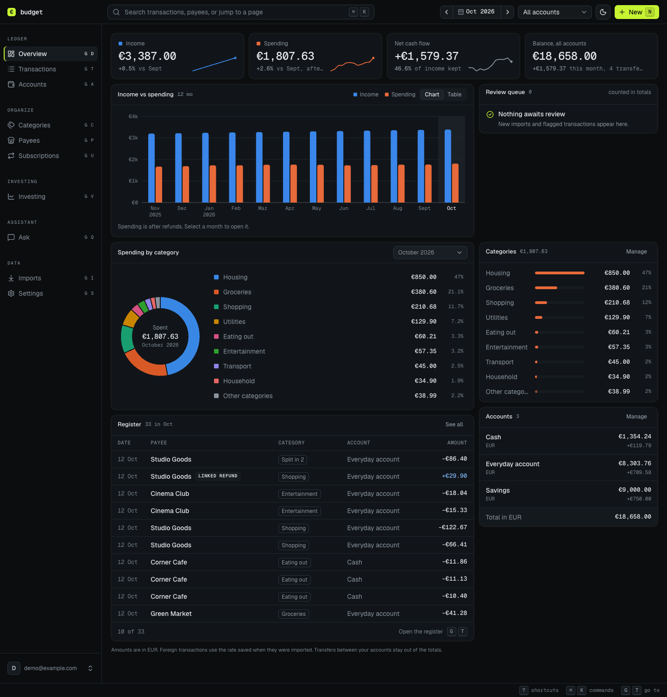
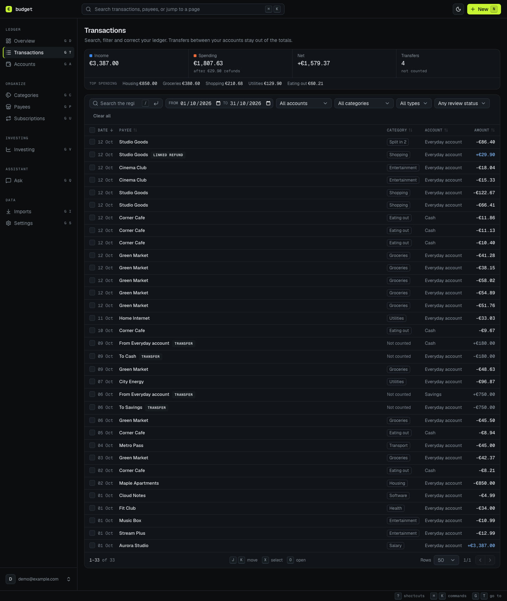
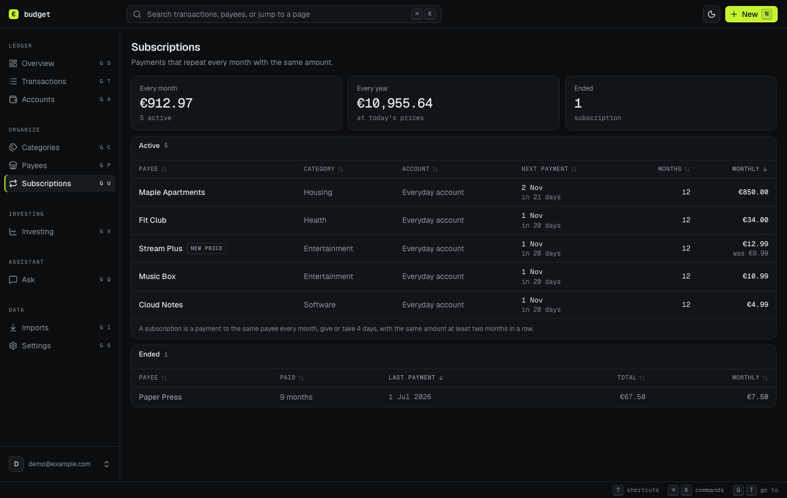

# Spend212

Expense tracker for Trading 212 and any bank.

Spend212 is a self-hosted expense tracker built around Trading 212. Connect your Trading 212 account to import card spending, income, and investments automatically. Statements from any other bank can be imported as CSV files, so all your spending is categorized and reviewed in one place.

The app has a Next.js frontend, a Go API, and encrypted SQLCipher storage. Go serves the static frontend and API from one origin.

Track transactions, accounts, categories, payees, subscriptions, and investments. CSV statements from Trading 212 and supported Slovak banks are recognized automatically. For other banks, you map the columns once and the mapping is reused for later files. Optional TypeSafe and Resend integrations provide AI assistance and email notifications. The interface supports English and Slovak, light and dark themes, and keyboard shortcuts.

## Preview

The screenshots show fictional demo data.



<details>
<summary>View the transaction register and recurring subscriptions</summary>





</details>

## Try the demo

After installing the prerequisites below and Python 3.9 or newer, run:

```sh
make install
make demo
```

Open <http://127.0.0.1:8088> and sign in with the public demo credentials `demo@example.com` and `Demo-budget-2026!`.

The demo creates an encrypted database under `.local/demo` with twelve months of fictional EUR transactions across everyday, savings, and cash accounts. It includes recurring subscriptions, account transfers, a linked refund, and a split expense. Repeated launches reuse the same data. Your normal database and key are separate.

`make demo` builds the app and starts the demo on loopback with Cloudflare's public test keys supplied to the server. Sign-in requires internet access for Cloudflare verification. Press **Ctrl+C** to stop it.

## Connect Trading 212

Trading 212's [Public API](https://docs.trading212.com/api) supports Invest and Stocks & Shares ISA accounts. Each user connects their own key in this app.

### Create an API key

1. Open Trading 212 on web or mobile and switch to the account you want to track, in live or practice mode.
2. Open **Settings > API (Beta) > Generate API key** and accept the required risk notice.
3. Name the key, for example `Budget tracking`, and select the permissions below.
4. If you enable trusted IP restrictions, allow the **public outbound IP of the server running this app**. API requests come from that server, so allowing only your browser's IP will not work when the app is hosted elsewhere.
5. Generate the key pair and copy both the **API Key** and **API Secret Key**. The secret is shown only once; if you lose it, generate a new pair.

See Trading 212's [official key creation guide](https://helpcentre.trading212.com/hc/en-us/articles/14584770928157-Trading-212-API-key) for the current screens and IP restriction options.

### Select permissions

To enable every feature in this app, select these permissions:

| Trading 212 permission | Used for |
| --- | --- |
| **Account data** | Identifying the linked account and reading its balance and portfolio summary. Required for every connection. |
| **History** | Generating and downloading reports for monthly card transactions and cashback. |
| **History - Transactions** | Importing interest on cash and share lending. |
| **History - Dividends** | Importing dividend payments. |
| **Pies - Read** | Reading pie values, results, and dividends. |

Leave trading and all write permissions disabled. This app does not place orders or change pies. Portfolio positions, metadata, and order history permissions are not used by the current integration.

If you only want some features, keep **Account data**, select the permissions for those features, and turn off the other sync options in this app before saving. Pie tracking also requires **Account summary** to be enabled.

### Save the connection

Open **Settings > Integrations > Trading 212** in this app. Choose **Live account** or **Practice account** to match where you created the key, enter the key and secret in their separate fields, name the linked account, and choose what to sync. Select **Check and save**.

The app checks the connection and reports missing permissions. If a required permission is missing, update the key's permissions in Trading 212 or turn off the corresponding sync option, then check again.

## Develop

The development commands work on Linux, macOS, and Windows through WSL 2. On Windows, [install WSL with Ubuntu](https://learn.microsoft.com/en-us/windows/wsl/install), clone the repository inside your Linux home directory, and run the commands in the Ubuntu terminal.

Install Node.js 24, Go 1.26, SQLCipher 4.19, a C compiler, Make, and OpenSSL. Install the shared tools:

```sh
npm install -g pnpm@11.20.0
go install github.com/sqlc-dev/sqlc/cmd/sqlc@v1.31.1
```

Ensure Go's binary directory is on your `PATH` so `sqlc` is available. The demo also requires Python 3.9 or newer.

<details>
<summary>Linux and Windows (Ubuntu or Debian): install SQLCipher and build dependencies</summary>

After installing Node.js and Go, run:

```sh
sudo apt-get update
sudo apt-get install -y build-essential curl git tcl libssl-dev sqlite3 python3
sqlcipher_build_dir=$(mktemp -d)
curl -fsSL https://codeload.github.com/sqlcipher/sqlcipher/tar.gz/refs/tags/v4.19.0 -o "$sqlcipher_build_dir/sqlcipher.tar.gz"
tar -xzf "$sqlcipher_build_dir/sqlcipher.tar.gz" -C "$sqlcipher_build_dir" --strip-components=1
(
  cd "$sqlcipher_build_dir"
  ./configure --prefix=/opt/sqlcipher --with-tempstore=yes --disable-static \
    CFLAGS="-O2 -DSQLITE_HAS_CODEC -DSQLITE_EXTRA_INIT=sqlcipher_extra_init -DSQLITE_EXTRA_SHUTDOWN=sqlcipher_extra_shutdown" \
    LDFLAGS="-lcrypto"
  make -j2
  sudo make install
)
```

This uses the same SQLCipher build configuration as the [Dockerfile](Dockerfile). For another installation directory, export `SQLCIPHER_PREFIX` before running Make.

</details>

<details>
<summary>macOS: install native dependencies</summary>

```sh
brew install go sqlcipher sqlc
```

Install the Xcode Command Line Tools with `xcode-select --install` if a C compiler is not already available.

</details>

From the repository root, run:

```sh
make install
make key
export APP_TURNSTILE_SITE_KEY=1x00000000000000000000AA
export APP_TURNSTILE_SECRET_KEY=1x0000000000000000000000000000000AA
make build
make run
```

Open <http://127.0.0.1:8080> and create the owner account. The exported keys are [Cloudflare's public test keys](https://developers.cloudflare.com/turnstile/troubleshooting/testing/) for local development. Use your own Turnstile widget and secret in production.

The server requires both `APP_TURNSTILE_SITE_KEY` and `APP_TURNSTILE_SECRET_KEY` at startup. The frontend reads the public site key from `/api/session`. Builds require neither key. The secret stays on the server for verification.

Run `make dev` for frontend hot reload and automatic backend rebuilds, then open <http://localhost:3000>. `WEB_PORT` changes the frontend port and `APP_LISTEN_ADDR` changes the API address. Local Go builds use `scripts/go.sh` to link SQLCipher instead of ordinary SQLite.

## Check changes

```sh
make check
make build
```

With `make run` running in another terminal, run `make smoke` to check the production frontend and API together. `make check` runs Go tests with the race detector, Go vet, ESLint, and TypeScript checks.

## Run with Docker

Copy `.env.example` to `.env` and set your Turnstile site key and secret. Docker Compose reads `.env`; the local `make run` and `make dev` commands require exported environment variables.

```sh
make key
make docker-up
make smoke
docker compose -f deploy/compose.yaml logs app
```

Both Turnstile keys are runtime environment variables. To change them, update `.env` and recreate the container with `docker compose --env-file .env -f deploy/compose.yaml up -d --no-build app`. The existing image works with the new keys without a rebuild.

To build and run the runtime image directly, export both keys as shown above, then run:

```sh
docker build --target runtime -t spend212:local .
docker run --rm -p 127.0.0.1:8080:8080 \
  -e APP_TURNSTILE_SITE_KEY -e APP_TURNSTILE_SECRET_KEY \
  -v budget_data:/data \
  -v "$PWD/.local/secrets/database.key:/run/secrets/database_key:ro" \
  spend212:local
```

The [prebuilt-image Compose file](deploy/compose.coolify.yaml) also requires both runtime keys. Set `APP_IMAGE` to the published image name and `APP_DATABASE_KEY` to your database encryption key before starting it.

The [local Compose file](deploy/compose.yaml) binds to `127.0.0.1:8080`, stores databases in the `budget_data` volume, and mounts the encryption key separately. Back up the database and its original key. `make key` refuses to overwrite an existing key.

## Disclaimer

Spend212 is an independent project. It is not affiliated with, endorsed by, or sponsored by Trading 212. Trading 212 is a trademark of its respective owner.
